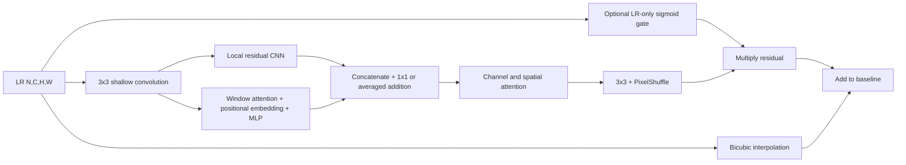

# Compact hybrid

| Operation | Shape |
|---|---|
| Input | N,C,H,W |
| Shallow/local/context features | N,D,H,W |
| Window tokens | (N*n_windows),w²,D |
| Concatenation | N,2D,H,W |
| Fusion projection | N,D,H,W |
| Reconstruction convolution | N,C*s²,H,W |
| PixelShuffle and final estimate | N,C,sH,sW |

D defaults to 16; two attention heads require even D. w defaults to 4. Replicate
padding extends incomplete windows, then is cropped. Learned within-window positions
provide positional information. There are no shifted windows: this is not SwinIR.
Scale supports 2 and 4. Input/output bands match and are configurable; no band mapping
is inferred. CNN features use zero-padded convolutions. Global channel attention means
tiled and whole-image hybrid inference can differ; tiling uses 32-pixel halos and
aligned window origins but does not promise seamless equality. CNN tiling is tested.

The gate only sees LR and attenuates the predicted correction. It is not uncertainty
calibration. Count parameters from the instantiated model; never borrow paper counts.
