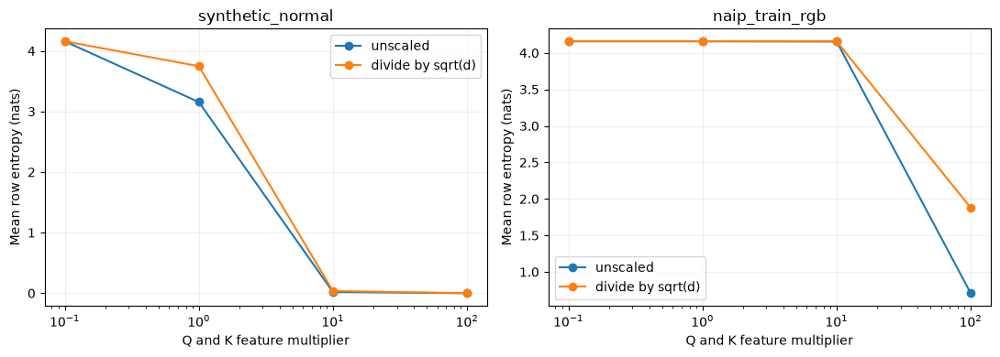
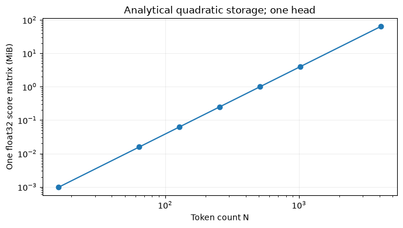

# MP27 — Self-Attention from Scratch

**Status: Complete (implementation and teaching deliverables)** · Learner mastery unassessed.

[Laboratory home](../../README.md) · [Stage overview](../README.md) · [Progress tracker](../../docs/progress.md)

## Learning objectives and prerequisites

Explain queries, keys, values, row softmax and quadratic token-pair storage. Predict a two-key weighted output, implement it and diagnose numerical failures. Prerequisite: [MP26](../../stage_06_attention/MP26_attention_based_sr_network/README.md), matrix multiplication and probability normalization.

## Implementation and mathematics

`Q` is N×d, `K` is M×d, `V` is M×dv. Compute A=softmax(QKᵀ/√d) across each row, then AV of shape N×dv. Self-attention normally uses N=M and projections from one sequence. The NumPy implementation is single-head float64 on CPU, without learned projections, positions or training. True mask entries permit keys; all-masked rows and nonfinite/empty/mismatched matrices are rejected. Inputs are not modified.

For Q=[1,0], K=[[1,0],[0,1]], V=[[10],[20]], logits are [1/√2,0], probabilities [0.669762,0.330238], output 13.302385. Subtracting each row maximum before exponentiation preserves the probabilities and avoids exponential overflow. Overflow before softmax is rejected.

Multiplying Q and K by c multiplies logits by c². The √d divisor moderates variance under independent unit-variance component assumptions; it does not make arbitrary feature scaling irrelevant. One dense float32 head uses 4N² score bytes, excluding Q/K/V, gradients and temporary buffers. Doubling tokens quadruples that quantity.

## Files and exact commands

- [Reusable implementation](attention_tools.py), [six tests](test_attention_tools.py), [experiment](experiment.py), [runner](run_notebook.py), [validation](VALIDATION.md).
- [Canonical notebook](self_attention_from_scratch.ipynb), with explanations, eight executable cells, plots, exercises and separate worked solutions. The notebook stays in the existing notebooks directory to preserve its canonical link; the local runner executes it in a real kernel.

From repository root, using the environment described in [setup](../../docs/setup.md):

```bash
python -m unittest discover -s stage_07_transformers/MP27_self_attention_from_scratch -p "test_*.py" -v
python stage_07_transformers/MP27_self_attention_from_scratch/experiment.py
python stage_07_transformers/MP27_self_attention_from_scratch/run_notebook.py
```

The notebook can inspect committed experiment evidence without local imagery. Re-running the experiment requires the existing checksum-pinned training raster under data/raw; see [rebuild instructions](../../docs/frozen-reproduction.md). No script downloads automatically. Executed notebooks remain under ignored data/executed_notebooks.

## Executed experiment and interpretation

Seed27, 64 tokens, d=3; fixed values and Q/K multipliers 0.1,1,10,100, with/without √d. Inputs: a seeded Gaussian fixture, then the central valid 8×8 RGB crop of the first NAIP training scene. The source SHA, crop, license, Python/NumPy versions and CPU runtime are in the [measured report](../../reports/mp27-self-attention.json).

The scaled Gaussian entropy falls from 4.159 nats to effectively zero. At multiplier100 the real crop entropy is 1.879 with scaling versus0.709 without. Row sums differ from one by at most5.56e-16; all outputs are finite. These results show saturation, not SR accuracy. The 4096-token analytical score matrix is64 MiB (float32, one head); no matrix of that size was allocated.




## Practice, reflection and limitations

Predict constant-value output, compute four-head memory, and explain why uniform attention is not an accuracy result before reading notebook solutions. Stable normalization and explicit shape contracts are useful; saturation still occurs. Next: positional encodings and multiple heads.

NAIP aerial imagery is public domain with USDA/OpenSR attribution retained; dataset card declares MIT. Values are fixed DN/10000, not verified reflectance. No validation/test samples, model optimization, satellite claim, performance superiority or learner assessment was used. The one-head primitive is not a full Transformer reproduction.

## Completion evidence

- [x] Explain dimensions and work through a checked mathematical example (notebook sections1–2).
- [x] Implement and execute the controlled feature-scale experiment (measured report).
- [x] Verify shape, mask, stability, permutation, memory and invalid-input cases (six tests).
- [x] Produce and interpret attention-scale and memory plots (notebook, figures).
- [x] Record source license, checksums, environment and limitations (report and validation).
- [x] Link actual evidence in the progress tracker; learner mastery remains unassessed.

## Reference

Vaswani et al., [Attention Is All You Need](https://arxiv.org/abs/1706.03762), scaled dot-product attention. This lesson implements the primitive, not the paper's full translation model.

## Project-folder files

This folder now contains the [local notebook](self_attention_from_scratch.ipynb), [local tools](attention_tools.py), [tests](test_attention_tools.py), [runner](run_notebook.py) and [validation](VALIDATION.md), following MP01's layout. Shared algorithms stay in src/rssr where applicable; local tools expose their API without divergent copies. Original notebooks/ snapshots and historical execution records are retained. This is the canonical notebook location for subsequent work.

From this directory, in the repository development environment:

```bash
python -m pytest -q test_attention_tools.py
python run_notebook.py
```

File presence does not imply that all scientific or educational criteria are complete. The status and remaining criteria above remain authoritative.
