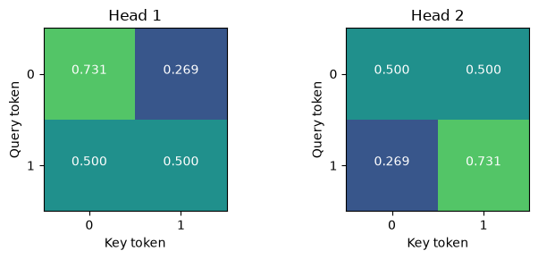
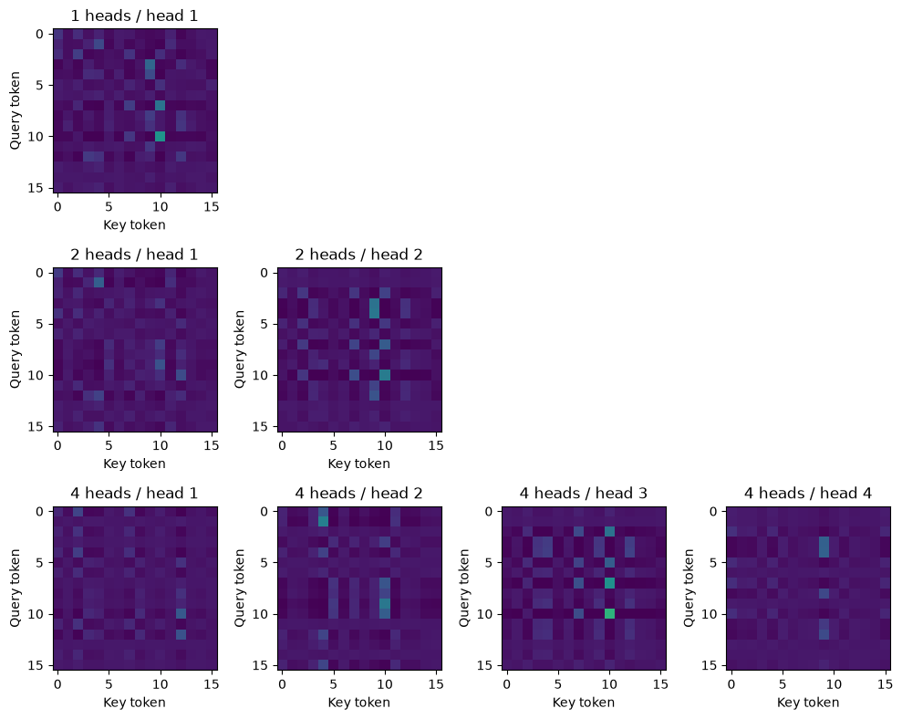

# MP28 — Multi-Head Self-Attention

**Status: Complete (implementation and teaching deliverables)** · Learner mastery unassessed.

[Laboratory home](../../README.md) · [Stage overview](../README.md) · [Progress tracker](../../docs/progress.md)

## Objectives and prerequisites

Understand feature projections, head splitting, concatenation and output projection; hand-check shapes and parameter counts. Prerequisite: [MP27](../MP27_self_attention_from_scratch/README.md) and matrix multiplication. This is a bias-free, untrained CPU NumPy implementation, not a full Transformer.

## Mathematics and worked example

For X[N,D], project Q=XWq, K=XWk, V=XWv using D×D matrices. Split into h heads with d=D/h; D must be divisible by h. Each head computes softmax(QjKjᵀ/√d)Vj of shape N×d. Concatenating gives N×D, then multiplication by Wo[D,D] gives N×D. Attention probabilities stack into h×N×N. No batch dimension, dropout, masks or positional encoding is included.

For N=3,D=4,h=2: two3×2 outputs concatenate to3×4; maps are2×3×3. Four bias-free projections contain4D²=64 entries, independent of head count at fixed D. With X=I₂ and identity projections, two scalar heads yield output[[p,0.5],[0.5,p]], where p=e/(e+1)=0.731059. The notebook independently checks this value.

## Files and commands

[Implementation](multihead_tools.py) · [Tests](test_multihead_tools.py) · [Experiment](experiment.py) · [Runner](run_notebook.py) · [Validation](VALIDATION.md) · [Canonical notebook](../../notebooks/MP28.ipynb).

From repository root in the [development environment](../../docs/setup.md):

```bash
python -m unittest discover -s stage_07_transformers/MP28_multi_head_self_attention -p "test_*.py" -v
python stage_07_transformers/MP28_multi_head_self_attention/experiment.py
python stage_07_transformers/MP28_multi_head_self_attention/run_notebook.py
```

The experiment reuses the pinned local training raster; [rebuild instructions](../../docs/frozen-reproduction.md). It never downloads automatically. The notebook reads committed measured evidence without requiring imagery. Its seven cells run in a real Jupyter kernel; outputs remain in ignored data/executed_notebooks.

## Executed experiment

Seed28, width4, sixteen tokens; identical Q/K/V/O matrices across1,2,4 heads. A Gaussian fixture precedes a valid4×4 NAIP training RGB crop embedded to width4 by a fixed3×4 random matrix. The embedding adds12 entries separately from the64 attention-projection entries. All six conditions produced finite outputs and normalized maps. Map arrays occupy2048,4096,8192 bytes for1,2,4 heads in float64, excluding other allocations. See [source, settings and measurements](../../reports/mp28-multihead.json).




Different subspaces create different attention maps even without learning. This is not evidence of semantic specialization or better SR. The real normalized crop remains close to uniform; input scale affects the comparison. Parameter count stays constant while map storage increases with heads. Holding per-head width instead would confound the comparison by increasing total width and parameters.

## Exercises, reflection and limitations

Before notebook solutions, predict D=4,h=3 behavior, zero output projection, and whether concatenation introduces positions. Answers: reject incompatible dimensions; zero output; no positional information. Learned: shape-preserving heads can compare different feature subspaces. Next: residuals, normalization and feed-forward networks in MP29.

All calculations use float64. The experiment is untrained and does not use validation/test data or report SR quality. NAIP aerial imagery is public domain with USDA/OpenSR attribution; the dataset card declares MIT. Values are DN/10000, physical calibration unverified. Source SHA and crop are in the measured report. No paid service or new dataset download.

## Completion criteria and evidence

- [x] Explain objectives and solve a small hand example (notebook sections1–2).
- [x] Implement and run one/multiple-head comparison (six conditions).
- [x] Verify numerical, shape, invalid-input and permutation contracts (five tests).
- [x] Deliver maps, shape trace and parameter counts with limited interpretation.
- [x] Document provenance, environment and deviations (report/validation).
- [x] Link evidence in progress; keep learner mastery unassessed.

## Reference

Vaswani et al., [Attention Is All You Need](https://arxiv.org/abs/1706.03762), multi-head attention. No full paper reproduction is claimed.
