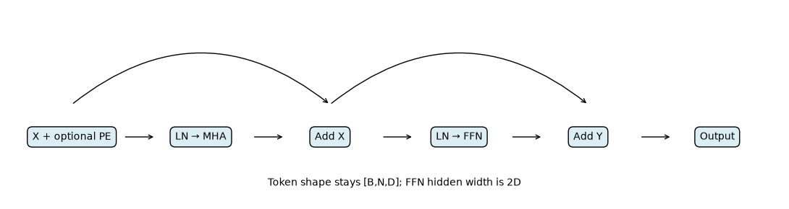
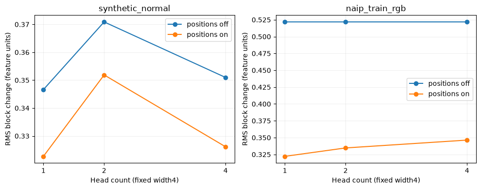

# MP29 — Transformer Encoder Block

**Status: Complete (implementation and teaching deliverables)** · Learner mastery unassessed.

[Laboratory home](../../README.md) · [Stage overview](../README.md) · [Progress tracker](../../docs/progress.md)

## Objectives and prerequisite

Combine multi-head attention, layer normalization, residuals and feed-forward projections; trace shapes and explain position sensitivity. Prerequisite: [MP28](../MP28_multi_head_self_attention/README.md). This pre-normalized, untrained educational variant is not an exact reproduction of the original post-normalized Transformer.

## Mathematics and hand example

Start with X[B,N,D] and optional sinusoidal PE[N,D]. Set Z=X+PE; Y=Z+MHA(LN₁(Z)); O=Y+Linear₂(GELU(Linear₁(LN₂(Y)))). Attention keeps D; the FFN expands D→2D→D. Each residual adds tensors of identical shape. LayerNorm uses per-token feature mean and population variance, epsilon1e-5, learned gain and bias. LN([1,3]) with unit gain/zero bias is[-1,1]/sqrt(1+1e-5). Constant-token variance is zero but the denominator is finite.

Positions use sin(p/10000^(2i/D)) and cos(p/10000^(2i/D)) in paired feature columns; width must be even. At p=0,D=4: [0,1,0,1]. Without positions, permuting tokens permutes output; fixed-slot positions break that property when contents move but slots stay fixed. Positional amplitude relative to input matters.

## Files and commands

[Implementation](encoder_tools.py) · [Tests](test_encoder_tools.py) · [Experiment](experiment.py) · [Runner](run_notebook.py) · [Validation](VALIDATION.md) · [Canonical notebook](transformer_encoder_block.ipynb).

From repository root in the [development environment](../../docs/setup.md):

```bash
python -m unittest discover -s stage_07_transformers/MP29_transformer_encoder_block -p "test_*.py" -v
python stage_07_transformers/MP29_transformer_encoder_block/experiment.py
python stage_07_transformers/MP29_transformer_encoder_block/run_notebook.py
```

No automatic download. Experiment uses the pinned local training raster from [rebuild instructions](../../docs/frozen-reproduction.md); the notebook reads committed measurements and runs synthetic checks without imagery. Executed output stays in ignored data/executed_notebooks.

## Executed controlled comparison

Seed29, CPU float64, one thread, width4, FFN width8, dropout0, GELU, biases and LayerNorm eps1e-5. Identical parameter state across1/2/4 heads; positions off/on; seeded Gaussian tokens then16 embedded RGB tokens from a valid4×4 training crop. All twelve conditions produced finite output. The encoder has172 scalar parameters for each head count; the separate RGB embedding adds12. No optimization or SR metric.




Actual trace: input, normalized features, attention, residual and output all[1,16,4]; FFN hidden[1,16,8]. [Measured report](../../reports/mp29-encoder.json) records full outputs, RMS changes, source checksum/license/crop and software. Response differences show representation sensitivity, not which configuration restores images better. Fixed order-one positions can dominate small normalized RGB features.

## Practice, reflection and limitations

Before notebook solutions, predict residual output when both learned branches are zero, calculate the normalization example, and identify why RMS is not accuracy. Answers: identity; the equation above; no reference target exists. Tests verify the identity path, finite gradients on constant tokens, position encoding, shape rejection and permutation behavior.

Learned: normalization and residual shape contracts are separate from attention. Failure cases: invalid heads, width, rank, empty/nonfinite tokens. Next: patches and window connectivity (MP30). NAIP is public-domain aerial imagery with USDA/OpenSR attribution (dataset card MIT); DN/10000 is not verified reflectance. No held-out/validation evaluation, training, masks, dropout, learned positional ablation or learner assessment.

## Completion criteria

- [x] Explain objectives and hand-check normalization/positions (notebook).
- [x] Implement and run positions/head-count comparison (twelve conditions).
- [x] Verify numerical, shape, edge and gradient checks (five tests).
- [x] Produce diagram, shape trace and interpreted response plots.
- [x] Record provenance, environment and pre-LN deviation (report/validation).
- [x] Link actual evidence in progress; learner mastery unassessed.

## Reference

Vaswani et al., [Attention Is All You Need](https://arxiv.org/abs/1706.03762). The lesson's pre-LN ordering is explicitly different from the original post-LN model.

## Project-folder files

This folder now contains the [local notebook](transformer_encoder_block.ipynb), [local tools](encoder_tools.py), [tests](test_encoder_tools.py), [runner](run_notebook.py) and [validation](VALIDATION.md), following MP01's layout. Shared algorithms stay in src/rssr where applicable; local tools expose their API without divergent copies. Original notebooks/ snapshots and historical execution records are retained. This is the canonical notebook location for subsequent work.

From this directory, in the repository development environment:

```bash
python -m pytest -q test_encoder_tools.py
python run_notebook.py
```

File presence does not imply that all scientific or educational criteria are complete. The status and remaining criteria above remain authoritative.
