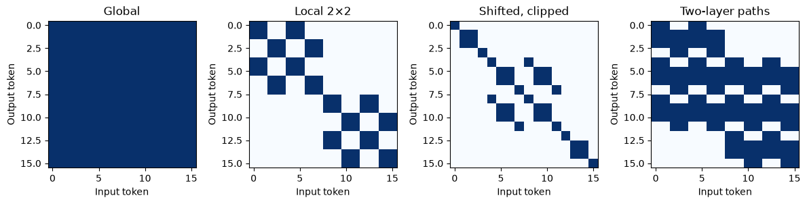
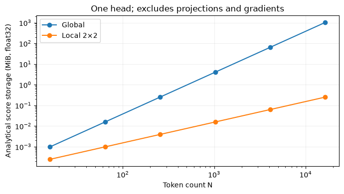

# MP30 — Image Patches and Window Attention

**Status: Complete (implementation and teaching deliverables)** · Learner mastery unassessed.

[Laboratory home](../../README.md) · [Stage overview](../README.md) · [Progress tracker](../../docs/progress.md)

## Objectives and prerequisites

Implement reversible patch ordering, distinguish patchification from learned embedding, compare global/local/shifted connectivity and estimate attention storage. Prerequisite: [MP29](../MP29_transformer_encoder_block/README.md).

## Mathematics, ordering and hand example

For H×W×C pixels and patch sizeP, N=(H/P)(W/P) tokens each holdP²C values. Require exact divisibility; no implicit padding. Token rows follow patch-grid row-major order. Within a token, rows, columns, channels flatten in that order. A4×4 single-channel ramp gives first2×2 token[0,1,4,5], second[2,3,6,7]. Inversion preserves original dtype and values. Shuffling tokens requires tracking their original spatial indices; a learned embedding is separate and need not be reversible.

Global score storage is N² entries, local M×M token windows use NM² for complete windows. Pairwise work is O(N²d) versus O(NM²d), excluding projections/FFN. For4×4 tokens and M=2:256 global versus64 local entries,1024 versus256 float32 bytes. Analytical counts are not peak RAM.

## Files and exact commands

[Implementation](window_tools.py) · [Tests](test_window_tools.py) · [Experiment](experiment.py) · [Runner](run_notebook.py) · [Validation](VALIDATION.md) · [Canonical notebook](image_patches_and_window_attention.ipynb).

From repository root in the [development environment](../../docs/setup.md):

```bash
python -m unittest discover -s stage_07_transformers/MP30_image_patches_and_window_attention -p "test_*.py" -v
python stage_07_transformers/MP30_image_patches_and_window_attention/experiment.py
python stage_07_transformers/MP30_image_patches_and_window_attention/run_notebook.py
```

Experiment requires the existing pinned training raster; [rebuild instructions](../../docs/frozen-reproduction.md). No automatic download. Notebook uses committed measured evidence plus synthetic checks; executed output is ignored under data/executed_notebooks.

## Executed experiments and interpretation

Synthetic ramp first, then a valid8×8 RGB training crop; patch sizes1,2,4. All six round trips were exact. Real pixels stay uint16, without resampling or calibration. Source checksum, license, crop and software are in the [measured report](../../reports/mp30-windows.json).




On a4×4 token grid:256 global pairs,64 aligned-local pairs,36 shifted/clipped pairs,144 reachable pairs after local then shifted layers. Shifted boundaries connect some prior window neighbors but do not wrap opposite image edges. The two-layer paths are not fully global. This is a clipped-boundary educational adjacency model, not Swin's cyclic-shift/masking implementation, and it does not compute learned attention probabilities.

## Practice, reflection and limits

Predict tokens for32×32 pixels/P=4, diagnose shuffled patch positions, and compare two-layer versus global connectivity before notebook solutions. Answers:64; inverse order must be tracked;144<256 in this example. Learned: exact patch reconstruction is independent from model quality. Next: measured Transformer/CNN restoration comparison (MP31).

NAIP is public-domain aerial data, USDA/OpenSR attribution retained, dataset-card MIT. No reflectance inference, training, downloads, validation/test access or SR-quality metric. Adjacency allocation is capped at4096 tokens; larger storage estimates are analytical. Learner mastery unassessed.

## Completion criteria

- [x] Explain patch dimensions and hand-compute ordering/storage.
- [x] Execute synthetic and real round trips plus connectivity comparisons.
- [x] Verify exact values/dtype, order, boundary behavior and invalid inputs (five tests).
- [x] Produce interpreted connectivity/memory figures and positional notes.
- [x] Record license, source hash, software and clipped-window deviation.
- [x] Link evidence in progress without claiming learner assessment.

## References

[Swin Transformer](https://arxiv.org/abs/2103.14030) · [SwinIR](https://arxiv.org/abs/2108.10257). Only connectivity concepts are illustrated; neither network is reproduced here.

## Project-folder files

This folder now contains the [local notebook](image_patches_and_window_attention.ipynb), [local tools](window_tools.py), [tests](test_window_tools.py), [runner](run_notebook.py) and [validation](VALIDATION.md), following MP01's layout. Shared algorithms stay in src/rssr where applicable; local tools expose their API without divergent copies. Original notebooks/ snapshots and historical execution records are retained. This is the canonical notebook location for subsequent work.

From this directory, in the repository development environment:

```bash
python -m pytest -q test_window_tools.py
python run_notebook.py
```

File presence does not imply that all scientific or educational criteria are complete. The status and remaining criteria above remain authoritative.
