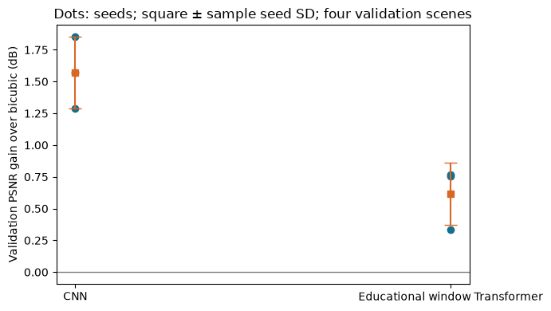

# MP31 — Transformer-Based SR Baseline

**Status: Complete (implementation and teaching deliverables)** · Learner mastery unassessed.

[Laboratory home](../../README.md) · [Stage overview](../README.md) · [Progress tracker](../../docs/progress.md)

## Objectives and prerequisites

Evaluate a compact window-based SR model against a CNN with shared data/metrics and declared compute; distinguish parameter count from latency and analyze an unfavorable result. Prerequisite: [MP30](../MP30_image_patches_and_window_attention/README.md).

## Reusable implementation and mathematics

The existing [SRModel/WindowBlock](../../src/rssr/models.py) is reused. RGBNIR input[B,4,H,W]→3×3 head/width16→unshifted4×4-token window block with two heads and learned positions→3×3 tail/16 channels→PixelShuffle×2/[B,4,2H,2W]. Add a bicubic skip. Replicated padding aligns boundary windows and is removed. This compact educational model lacks faithful shifted-window stacks/residual Swin groups; it is not official SwinIR.

PSNR=10log10(range²/MSE); range1/MSE0.01 gives20dB. Equal-weight scene means of tile metrics are retained; pooling MSE then converting to PSNR would be a different aggregation. Seed SD is descriptive training variation, not geographic confidence.

## Files and commands

[Evidence/benchmark code](benchmark_tools.py) · [Tests](test_benchmark_tools.py) · [Runner](run_notebook.py) · [Validation](VALIDATION.md) · [Canonical notebook](transformer_based_sr_baseline.ipynb).

From repository root in the [development environment](../../docs/setup.md), with the package installed:

```bash
python -m unittest discover -s stage_07_transformers/MP31_transformer_based_sr_baseline -p "test_*.py" -v
python stage_07_transformers/MP31_transformer_based_sr_baseline/benchmark_tools.py
python stage_07_transformers/MP31_transformer_based_sr_baseline/run_notebook.py
```

The exporter reads existing measured reports only; no imagery/checkpoint download, retraining, timing repetition or frozen-test access. It pins both source hashes and reconciles reported deltas against per-scene PSNR. Notebook executes a separate tiny untrained synthetic shape check and reads measured evidence.

## Declared benchmark and actual result

Four train/four validation NAIP scenes,16 fixed patches/scene, RGBNIR DN/10000 (not calibrated reflectance). Gaussian sigma0.8/area x2 LR; range1,border2,no clipping/luminance conversion. Adam0.001,batch4,L1,1000 updates; minimum validation L1 checkpoint every100; seeds17/23/41. Same updates are not equal parameters/time. Existing [development runs](../../reports/submission-study.json) and [efficiency report](../../reports/development-benchmark.json) remain unchanged.

| Model | Parameters | Mean validation gain over bicubic | Sample seed SD |
|---|---:|---:|---:|
| CNN | 7552 | 1.570925 dB | 0.281768 dB |
| Educational window Transformer | 5392 | 0.618003 dB | 0.246293 dB |



[Teaching export](../../reports/mp31-transformer-sr.json) includes run/checkpoint/manifest IDs, configurations, training times and original CPU efficiency rows. Timing used input[1,4,64,64], five warmups/twenty repetitions and the recorded CPU/thread environment. Partial MACs exclude several operations; sampled process RSS is not allocator peak. Parameters alone cannot predict runtime.

## Failure analysis, practice and reflection

CNN exceeds this Transformer by0.952921dB mean validation gain under this protocol. Insufficient training, capacity, windows or small data are possible explanations, not isolated causes. No Transformer superiority is supported. A future test should predeclare one factor on development data; never retune/repeat the frozen test.

Before notebook solutions, compute the mean-gain gap and explain parameter/latency and seed/geography distinctions. Learned: architecture labels are not evidence of restoration benefit. Next: stage08 hybrid fusion with the existing baselines preserved.

Official pretrained SwinIR is a separate RGB/DIV2K-pretrained comparison with different degradation/budget; it is not pooled into this four-band table. NAIP is public-domain aerial data with USDA/OpenSR attribution (dataset card MIT). No real-satellite generalization, reflectance or learner mastery claim.

## Completion criteria

- [x] Explain common metric/shape conventions and a numerical PSNR example.
- [x] Implement and execute a reproducible benchmark export from already executed experiments.
- [x] Verify exact source arithmetic, parameter counts, finite odd-size output and bicubic zero-residual control (three tests).
- [x] Deliver measured table/plot, compute context and failure analysis.
- [x] Preserve provenance, source hashes, unequal-budget and architecture limitations.
- [x] Link validation/progress without conflating implementation and learner completion.

## References

[Swin Transformer](https://arxiv.org/abs/2103.14030) · [SwinIR](https://arxiv.org/abs/2108.10257). Compact educational baseline and official model remain explicitly separate.

## Project-folder files

This folder now contains the [local notebook](transformer_based_sr_baseline.ipynb), [local tools](benchmark_tools.py), [tests](test_benchmark_tools.py), [runner](run_notebook.py) and [validation](VALIDATION.md), following MP01's layout. Shared algorithms stay in src/rssr where applicable; local tools expose their API without divergent copies. Original notebooks/ snapshots and historical execution records are retained. This is the canonical notebook location for subsequent work.

From this directory, in the repository development environment:

```bash
python -m pytest -q test_benchmark_tools.py
python run_notebook.py
```

File presence does not imply that all scientific or educational criteria are complete. The status and remaining criteria above remain authoritative.
