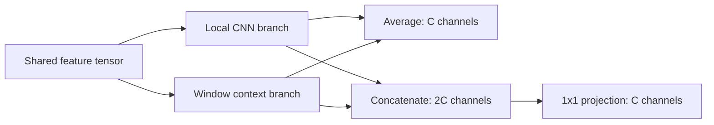

# MP37 - Feature Fusion Laboratory

**Status: Complete** (implementation/teaching scope). Expanded implementation and teaching checks; learner mastery is unassessed. Research-grade superiority is not claimed.

[Laboratory home](../../README.md) · [Stage overview](../README.md) · [Progress](../../docs/progress.md)

## Objectives and prerequisites

Explain sum, mean and concatenation/projection; derive shapes and costs; show how a projection can represent averaging; interpret a controlled fixture separately from historical training results. Reuse CNN/window features from MP26-MP31. [MP36](../../stage_08_remote_sensing/MP36_cross_sensor_dataset_investigation/README.md) remains necessary before real cross-sensor claims, but is not needed for this synthetic tensor lesson.

## Mathematics and conventions

A,B are aligned floating-point tensors of shape N,C,H,W (batch, channel, height, width), on the same device/dtype. Feature values have learned arbitrary units, not physical reflectance. Sum S=A+B and mean M=(A+B)/2 retain C channels; concatenation Z=[A;B] has2C channels. A biased1x1 projection P maps Z back toC: Y=P_A A+P_B B+b at every pixel. Setting P_A=P_B=I/2 and b=0 reproduces averaging. This is an expressivity statement, not a claim that training discovers useful weights.

The projection has2C^2+C parameters and NHW*2C^2 MACs. A MAC is a multiply-accumulate pair; bias additions, feature copies, branch costs and activations are excluded. These are not full-model FLOPs. Averaging uses no trainable projection parameters. Derivatives of sum with respect to either branch are1; mean gives1/2. This changes gradient scale and can confound training comparisons.

Worked example: A=[1,2], B=[3,4]. Sum=[4,6], mean=[2,3], concatenation=[1,2,3,4]. A2x4 projection with half-identity blocks yields[2,3]. For C=8,H=5,W=7,N=1, the projection costs136 parameters and4480 MACs. Channel correspondence is assumed for sum/mean; spatial misalignment cannot be fixed merely by concatenating.



## Executed experiment and evidence

[experiment.py](experiment.py) uses the shared SRModel, CPU float32, seed17 and two threads. It copies every common parameter between the two fusion variants and initializes the concat projector as the exact mean. A synthetic1x3x5x7 input produces1x3x10x14 outputs. This isolates algebra/shape behavior; no training, checkpoint selection, imagery download or held-out inference occurs. Shared WindowBlock uses replicated boundary padding before cropping back to the original feature size.

[Report](../../reports/mp37-fusion.json) records actual output difference, shapes, counts, gradients and environment. It separately reads existing ablation-pilot-runs.json by variant/run ID with its canonical hash. Those historical real-NAIP validation results used three seeds,100 steps, one validation scene and unequal parameter counts. Their mean/seed SD are not new measurements, geographic confidence intervals or a matched-budget causal comparison. Larger trained-model differences cannot be attributed solely to fusion capacity. Frozen results are unchanged.

## Run and inspect

From repository root with the existing development environment:

```bash
python -m pytest -q stage_09_hybrid_research/MP37_feature_fusion_laboratory
python stage_09_hybrid_research/MP37_feature_fusion_laboratory/experiment.py
python stage_09_hybrid_research/MP37_feature_fusion_laboratory/run_notebook.py
```

Local files follow MP01: [notebook](feature_fusion_laboratory.ipynb), [tools](mp37_tools.py), [tests](test_mp37_tools.py), [runner](run_notebook.py), [validation](VALIDATION.md). Historical central notebooks stay unchanged. Synthetic fixtures have no third-party imagery license. Historical source licensing/provenance remains in the original pilot manifests; this report contains only derived numbers and run IDs.

## Practice and solutions

1. For N=2,C=4,H=3,W=5, derive concat shape and projection cost. **Solution:**2x8x3x5,36 parameters,960 MACs.
2. Can a1x1 projection implement A-B? **Solution:** P_A=I,P_B=-I,b=0; negative weights are allowed. It cannot perform a spatial shift by itself.
3. Why does averaging cancel opposite features? **Solution:** if B=-A, M=0, losing branch identity. Concatenation retains both before projection, but the projection can still discard them.
4. Does identical output under the mean initialization prove equal trained performance? **Solution:** no; parameterization, optimization, budgets and initialization differ. Use an independently registered matched-budget study for that claim.
5. What happens for integer inputs, empty spatial axes, NaNs or mismatched shapes? **Solution:** local tools reject them explicitly; no silent casting/broadcasting.

## Completion criteria

- [x] Written objectives, defined symbols, worked example and solved exercises.
- [x] Controlled synthetic experiment and historical validation interpretation recorded.
- [x] Relevant local tests and expanded real-kernel notebook pass.
- [x] Diagram, parameter/MAC convention, limitations and reproducible commands supplied.
- [x] Link final validation and update implementation status after kernel acceptance.

These criteria concern implementation/teaching deliverables, not learner mastery or completion of the larger research study.
