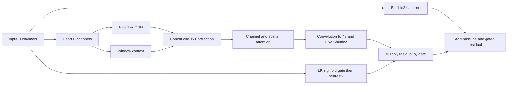

# MP38 — Hybrid CNN–Attention–Transformer SR Model

**Status: In progress** · **Curriculum: proposed for review**

[Laboratory home](../../README.md) · [Stage overview](../README.md) · [Progress tracker](../../docs/progress.md)

Architecture teaching component expanded and executed; matched-budget quality study and error atlas remain pending. This is not learner completion. Historical central notebook evidence is preserved.

## Learning objectives

- Integrated architecture and reconstruction.
- Explain the mathematical model below and its assumptions in your own words.
- Interpret the planned comparison using evidence and identify a limitation.

## Prerequisites

[MP37 — Feature Fusion Laboratory](../../stage_09_hybrid_research/MP37_feature_fusion_laboratory/README.md) and the earlier foundations in the roadmap.

Read the root setup guide. Use synthetic inputs first and document any external dataset source, license, and preprocessing. References are reading suggestions; a compact educational model need not reproduce a full published architecture.

## Mathematics

Trace CNN extraction, attention gating, Transformer context, feature fusion, and residual upsampling in one reconstruction equation.

Write down variable dimensions and units before coding. Work through one small numerical example and define edge cases; equations here specify topics to study, not measured results.

## Experiments

**Planned; not run.** Plan an integrated hybrid against matched CNN and Transformer baselines on fixed pairs; deliver an architecture specification, quality/compute table, and error crops when implemented.

1. Define the question, baseline, controlled variables, input selection, and expected sanity checks before implementation.
2. Begin with a tiny deterministic fixture, then use a documented sample. Change one factor at a time.
3. Record settings, seeds, package versions, runtime/device, and observations. Training projects must keep validation and held-out test data separate.
4. Compare outcomes, explain failure cases, and record limitations. Do not tune on the test set.
- Remote sensing: preserve CRS, affine transform, band meaning, nodata, physical units, and source licenses. Split by region/scene before tiling.

## Deliverables

- The project-specific plots, tables, specifications, or reports named in the experiment above, when the project is implemented.
- Project-local experiment, expanded notebook and exact commands are provided below; remaining scientific acceptance is explicit.
- An experiment record with data provenance, configuration, checks, results, and interpretation. Keep large data, weights, and generated artifacts outside Git; link a reproducible artifact manifest instead.
- A short reflection: what was learned, what failed, and the next question.

## References

- [Stage reference: Hybrid research](https://arxiv.org/abs/2205.04437)

## Completion criteria

- [ ] Explain the learning objectives and solve the small mathematical example.
- [ ] Implement and run the planned experiment with a documented command and reproducible inputs.
- [ ] Verify relevant numerical, shape, and edge-case checks; record the actual outcomes.
- [ ] Produce the project-specific deliverables and interpret the baseline comparison without unsupported claims.
- [ ] Document data licenses, environment, limitations, and any deviations from the brief.
- [ ] Link evidence in the progress tracker and change status only after all criteria are met.

## Project-folder files

This folder now contains the [local notebook](hybrid_cnn_attention_transformer_sr_model.ipynb), [local tools](mp38_tools.py), [tests](test_mp38_tools.py), [runner](run_notebook.py) and [validation](VALIDATION.md), following MP01's layout. Shared algorithms stay in src/rssr where applicable; local tools expose their API without divergent copies. Original notebooks/ snapshots and historical execution records are retained. This is the canonical notebook location for subsequent work.

From this directory, in the repository development environment:

```bash
python -m pytest -q test_mp38_tools.py
python run_notebook.py
```

File presence does not imply that all scientific or educational criteria are complete. The status and remaining criteria above remain authoritative.


## Executed architecture lesson — 2026-10-27

[experiment.py](experiment.py) and [architecture report](../../reports/mp38-architecture.json) trace actual shared `rssr.models.SRModel` modules, without a second model implementation. CPU float32, seed38, two threads; RGB and four-band synthetic1xBx5x7 inputs. No image download, optimizer step, checkpoint selection or test evaluation. Feature values are arbitrary learned units; input fixture values are synthetic0..1, not calibrated imagery.

Let F=H(x) be the3x3 head output withC channels. Local branch L=F+CNN(F); context branch T=WindowBlock(F). Fuse Z=Conv1x1([L;T]) then apply channel/spatial attention A(Z). The residual is R=PixelShuffle2(Conv3x3(A(Z))); optional LR-only sigmoid gate g(x) is nearest-upsampled. Reconstruction is y=bicubic2(x)+upsample2(g(x))*R. Without the optional gate, its factor is1. The attention block reweights features; it is neither calibrated uncertainty nor a causal explanation. Window attention uses replicated padding and restores the original feature grid.



For B=4,C=8,H=5,W=7: head/local/context are1x8x5x7, concatenation1x16x5x7, projection1x8x5x7. The tail convolution produces1x16x5x7 and PixelShuffle gives1x4x10x14. Gate output before upsampling is1x4x5x7. PixelShuffle changes layout: each low-resolution location supplies four subpixel positions per output band; it does not prove new detail.

### Initialization and gradients

If tail weights/bias are zero, R=0 and output exactly equals bicubic, whatever the gate values. d(y)/d(g)=R, so the gate initially receives zero gradient, while the tail can receive nonzero gradients. Zero gate gradient at this initialization is therefore expected, not proof of a broken optimizer. Worked scalar example: baseline.4, residual.1, gate.5 gives.45; zero residual gives.4. No clipping is hidden in this equation.

### Practice and solutions

1. How many pre-shuffle channels for B=3 and scale2? **Answer:**3*2^2=12.
2. Does a high gate value certify accuracy? **Answer:**no; it is a learned multiplier without uncertainty calibration.
3. Can a zero-initialized residual establish SR improvement? **Answer:**no, it reproduces the interpolation baseline by construction.
4. Why is the historical hybrid/CNN table not the planned matched-budget comparison? **Answer:**architecture parameters/training controls differ; use the preregistered v2 accounting and independent regions before making that claim.

### Verification and remaining scientific work

Run from root: `python -m pytest -q stage_09_hybrid_research/MP38_hybrid_cnn_attention_transformer_sr_model`, then `python stage_09_hybrid_research/MP38_hybrid_cnn_attention_transformer_sr_model/experiment.py`, then the local runner. Tests cover dimensions, finite gradients, hook cleanup on failure, restored train/eval state and bicubic identity. Shape traces are actual forward-pass observations; parameter totals are implementation counts, not latency/FLOP measurements.

[Existing paper tables](../../paper/generated/results.tex) keep historical quality evidence separate. The planned matched-budget CNN/Transformer study, reference-error crops and complete quality/compute comparison remain unfinished under [protocol v2](../../docs/protocol-v2.md). Do not mark MP38 complete from the architecture fixture alone. Synthetic tensors require no imagery license. No external paper reproduction or scientific novelty is claimed.
