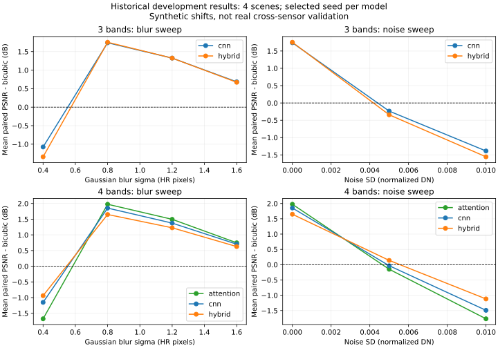

# MP40 — Robustness and Efficiency Benchmark

**Status: In progress** · **Curriculum: proposed for review**

[Laboratory home](../../README.md) · [Stage overview](../README.md) · [Progress tracker](../../docs/progress.md)

Historical robustness/efficiency analysis expanded; real cross-sensor and complete compute/memory acceptance remain open. Learner mastery is unassessed.

## Learning objectives

- Blur, noise, cross-sensor shift, parameters, FLOPs, inference time and GPU memory.
- Explain the mathematical model below and its assumptions in your own words.
- Interpret the planned comparison using evidence and identify a limitation.

## Prerequisites

[MP39 — Controlled Ablation Study](../../stage_09_hybrid_research/MP39_controlled_ablation_study/README.md) and the earlier foundations in the roadmap.

Read the root setup guide. Use synthetic inputs first and document any external dataset source, license, and preprocessing. References are reading suggestions; a compact educational model need not reproduce a full published architecture.

## Mathematics

Define severity-dependent metric changes, parameter counts, declared FLOP conventions, latency distributions, and peak memory measurements.

Write down variable dimensions and units before coding. Work through one small numerical example and define edge cases; equations here specify topics to study, not measured results.

## Experiments

**Historical synthetic sweeps/CPU benchmark available; cross-sensor study incomplete.** Reuse the existing development benchmark; derive curves/tables without re-running inference or claiming GPU results.

1. Define the question, baseline, controlled variables, input selection, and expected sanity checks before implementation.
2. Begin with a tiny deterministic fixture, then use a documented sample. Change one factor at a time.
3. Record settings, seeds, package versions, runtime/device, and observations. Training projects must keep validation and held-out test data separate.
4. Compare outcomes, explain failure cases, and record limitations. Do not tune on the test set.
- Remote sensing: preserve CRS, affine transform, band meaning, nodata, physical units, and source licenses. Split by region/scene before tiling.

## Deliverables

- The project-specific plots, tables, specifications, or reports named in the experiment above, when the project is implemented.
- Project-local experiment, expanded notebook and exact commands are provided below; remaining scientific acceptance is explicit.
- An experiment record with data provenance, configuration, checks, results, and interpretation. Keep large data, weights, and generated artifacts outside Git; link a reproducible artifact manifest instead.
- A short reflection: what was learned, what failed, and the next question.

## References

- [Stage reference: Hybrid research](https://arxiv.org/abs/2205.04437)

## Completion criteria

- [ ] Explain the learning objectives and solve the small mathematical example.
- [ ] Implement and run the planned experiment with a documented command and reproducible inputs.
- [ ] Verify relevant numerical, shape, and edge-case checks; record the actual outcomes.
- [ ] Produce the project-specific deliverables and interpret the baseline comparison without unsupported claims.
- [ ] Document data licenses, environment, limitations, and any deviations from the brief.
- [ ] Link evidence in the progress tracker and change status only after all criteria are met.

## Project-folder files

This folder now contains the [local notebook](robustness_and_efficiency_benchmark.ipynb), [local tools](mp40_tools.py), [tests](test_mp40_tools.py), [runner](run_notebook.py) and [validation](VALIDATION.md), following MP01's layout. Shared algorithms stay in src/rssr where applicable; local tools expose their API without divergent copies. Original notebooks/ snapshots and historical execution records are retained. This is the canonical notebook location for subsequent work.

From this directory, in the repository development environment:

```bash
python -m pytest -q test_mp40_tools.py
python run_notebook.py
```

File presence does not imply that all scientific or educational criteria are complete. The status and remaining criteria above remain authoritative.


## Executed analysis and curve interpretation — 2026-10-27

[experiment.py](experiment.py) derives [30 condition rows and5 efficiency records](../../reports/mp40-benchmark-analysis.json) from unchanged development-benchmark.json, pinned by canonical hash. [Robustness curves](../../reports/figures/mp40-robustness.svg) show RGB/four-band protocols separately. Each point is the mean of four scene-paired model-minus-bicubic PSNR differences. Lines connect only recorded conditions; they are not continuous predictions. Selected best-validation seeds introduce optimism; these are development results, not fresh test evidence.



Blur sweep uses sigma_HR=.4,.8,1.2,1.6 pixels with noise0. Noise sweep uses sigma_HR=.8 and noise SD0,.005,.01 in normalized-DN units. These two sweeps change one nuisance parameter at a time; do not connect unlike conditions on an unlabeled severity axis. Blur/noise simulation does not reproduce sensor spectral response, registration error or acquisition-time changes. Benefits near the training degradation can disappear under mismatch. Negative values mean bicubic has higher mean PSNR for that condition; no result is omitted for being negative.

## Mathematics and measurement conventions

For scene j and condition c, d_j(c)=PSNR_model,j(c)-PSNR_bicubic,j(c). Report mean_j d_j(c). A model can lose raw PSNR under noise while its relative delta changes differently because the baseline also degrades. Example: model30->25dB, baseline28->26dB yields delta+2->-1dB. A dB difference is not percent improvement.

Latency samples t1..tK are elapsed forward times after warmup. Median is a typical sampled latency; p95 describes a sample upper quantile, not a worst-case guarantee. The historical record uses CPU float32, two threads, batch1,64-square inputs,5 warmups and20 repetitions, excluding IO/tiling. Do not compare this with web end-to-end response time. An illustrative2ms versus4ms gives2x speed ratio only with equal workload; it does not imply2x reconstruction quality.

Parameters count stored trainable scalars. The recorded conv/linear/attention MAC subset uses2 counted FLOPs per MAC and explicitly excludes normalization, activations, pooling, softmax, interpolation and elementwise operations. It is NOT total FLOPs. Sampled process peak RSS includes Python/caches and can miss peaks; it is NOT allocator peak or model-only memory. GPU memory is unavailable because no GPU ran. Unknown measurements remain unavailable, never zero.

## Exercises and solutions

1. Why separate3-band and4-band rows? **Answer:**different data/metric and workload contracts make pooled rankings misleading.
2. Can low CPU median prove a free host completes65536-square output? **No.** Workload, IO, tiling, memory and host limits differ.
3. Can mild synthetic blur establish real cross-sensor robustness? **No.** It tests only that declared degradation family.
4. Why preserve negative delta points? **Answer:**they reveal degradation mismatch and prevent favorable-condition selection.
5. Should missing GPU memory be displayed0? **No.** Use unavailable/not applicable and state no GPU used.

## Run and remaining acceptance

Run the local tests, `experiment.py` and `run_notebook.py` from repository root as for earlier projects. The experiment reads existing reports and generates SVG; it does not acquire imagery, train or time models again. `benchmark_cpu` remains a separately tested timing helper, not an automatically rerun research benchmark. Historical imagery provenance/licenses stay with original manifests; this report redistributes derived numbers only.

Partial implementation acceptance: derived curves/table, source lineage, numerical tests, equations/exercises and real kernel. Full MP40 remains In progress for real cross-sensor shift, complete operation accounting and appropriately scoped peak memory evidence. No GPU is required merely to fabricate a missing GPU row. [Validation](VALIDATION.md) records actual checks; [protocol v2](../../docs/protocol-v2.md) governs new studies.
